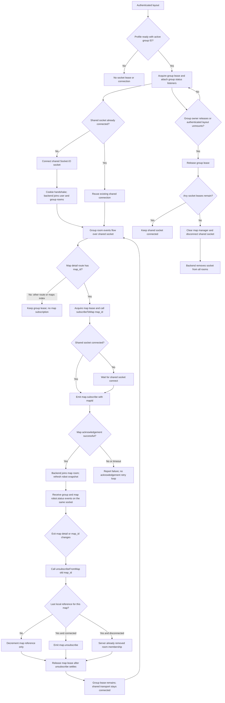

# Socket.IO room connection flow

This document describes how the frontend owns its shared Socket.IO connection and joins or leaves
the backend's automatic group room and explicit map rooms.

## High-level lifecycle

The Socket.IO client is created once in `src/realtime/socket.ts` with `autoConnect: false`. Every
consumer receives that same socket through a lease. The authenticated handshake joins the user and
active group rooms automatically; the frontend does not send group or room names. A map detail page
adds an explicit map room on the same socket, so that socket can receive events addressed to both
its group and map rooms.

## Connection and subscription ownership

| Owner | When it acquires | What it does | When it releases |
| --- | --- | --- | --- |
| Authenticated layout group hook | Profile query succeeded and an active group ID exists, on any authenticated route | Adds robot status/connect/error listeners and calls `connect()` | Profile/group becomes unavailable, group ID changes, or authenticated layout unmounts |
| Map detail hook | Profile query succeeded and a map detail route supplies its URL map ID | Adds its listeners and calls `subscribeToMap(mapId)`; this uses the existing shared socket | Route exits, map ID changes, group context changes, or hook unmounts |
| Maps index | No map-specific lease | Uses the authenticated layout's group connection; does not subscribe to a map room | Not applicable |

`acquireRealtimeConnection()` increments the shared socket's consumer count. Releasing a lease only
disconnects when the count reaches zero. Release is idempotent. This protects the connection if
multiple mounted consumers temporarily share it.

`subscribeToMap(mapId)` checks that the ID is a UUID and tracks references per map ID. The first
reference emits `map.subscribe`; additional references share the pending or completed subscription.
Only the final matching `unsubscribeFromMap(mapId)` reference emits `map.unsubscribe`.

## Disconnect and unsubscribe paths

### Entering a map detail route

The authenticated layout keeps the group hook and shared socket active. The map detail hook adds its
own lease and listeners, then calls `subscribeToMap(mapId)` with the URL parameter. Since the group
hook already owns the shared socket, entering map detail does not create or reconnect a transport;
it emits `map.subscribe` over the existing connection. The maps index has no map ID, so it does not
subscribe to a map room.

### Leaving a map detail page, changing its map ID, or changing group context

The map hook cleanup marks its subscription callback as disposed and removes its socket listeners.
It then calls `unsubscribeFromMap(oldMapId)`. If other consumers still reference the same map ID,
the manager only decrements the count. On the final reference, it emits `map.unsubscribe` if the
socket is connected and the room had been joined or a subscribe was pending. The map lease is
released after the unsubscribe Promise settles; if it was the last socket lease, the manager clears
its state and disconnects.

When the socket is already disconnected, the backend has already removed the socket from all
rooms, so the manager skips the leave event. A new map ID is subscribed after the old hook cleanup
and the new hook setup.

### Leaving map detail for another authenticated route or the maps index

The map detail hook unsubscribes its map ID and releases its lease. The authenticated layout's group
lease remains active throughout, so the shared transport does not disconnect. The backend's
automatic group membership remains in place, and the group hook continues receiving status events.
The maps index does not add a map-room lease.

### Final consumer release

Whenever the consumer count reaches zero—such as leaving the authenticated layout or losing the
active group—the manager clears local map-room state and calls `socket.disconnect()`. Socket.IO
stops its reconnection attempts for that socket; the server removes the connection from all rooms.
Leaving map detail alone does not disconnect the transport because the authenticated layout still
owns its group lease.

### Unexpected transport disconnect and reconnect

Socket.IO retries temporary transport failures with exponential delay, capped at 30 seconds, and
randomization. On disconnect, the map manager marks active map subscriptions as not joined. After
the next `connect`, it resubscribes maps that still have references. A failed room acknowledgement
is reported and does not trigger an acknowledgement retry loop. The robot list snapshot is
invalidated on connect, and after a successful map-room join, to cover events missed while offline
or while joining.

## Failure behavior

- Missing profile or active group ID: the hooks do not acquire a lease or open the connection.
- Invalid map ID: the manager returns an `INVALID_PAYLOAD` acknowledgement without emitting a room
  event.
- Rejected or timed out map acknowledgement: the hook reports the failure. It waits for a new
  connection or corrected access; it does not continuously retry the failed acknowledgement.
- Connect error: the hook reports the error. Socket.IO handles transport retries; a rejected
  authentication/access handshake requires correcting the underlying session/access.
- Unsubscribe error: the hook reports the failure and still releases the lease after the promise
  settles. If the final lease is released, disconnect removes server-side room membership.

## Relevant implementation

- `src/realtime/socket.ts` — singleton socket configuration, shared lease count, and final disconnect.
- `src/realtime/map-rooms.ts` — map ID validation, per-map reference counts, acknowledgements, and
  resubscription after reconnect.
- `src/hooks/use-robot-status-socket.ts` — group and map listeners, map subscribe/unsubscribe, and
  cleanup behavior.
- `src/components/layouts/auth_layout.tsx` — persistent group connection owner across authenticated routes.
- `src/routes/_authenticated/operations/maps/$map_id.tsx` — map ID from the route URL and map-hook
  owner.

